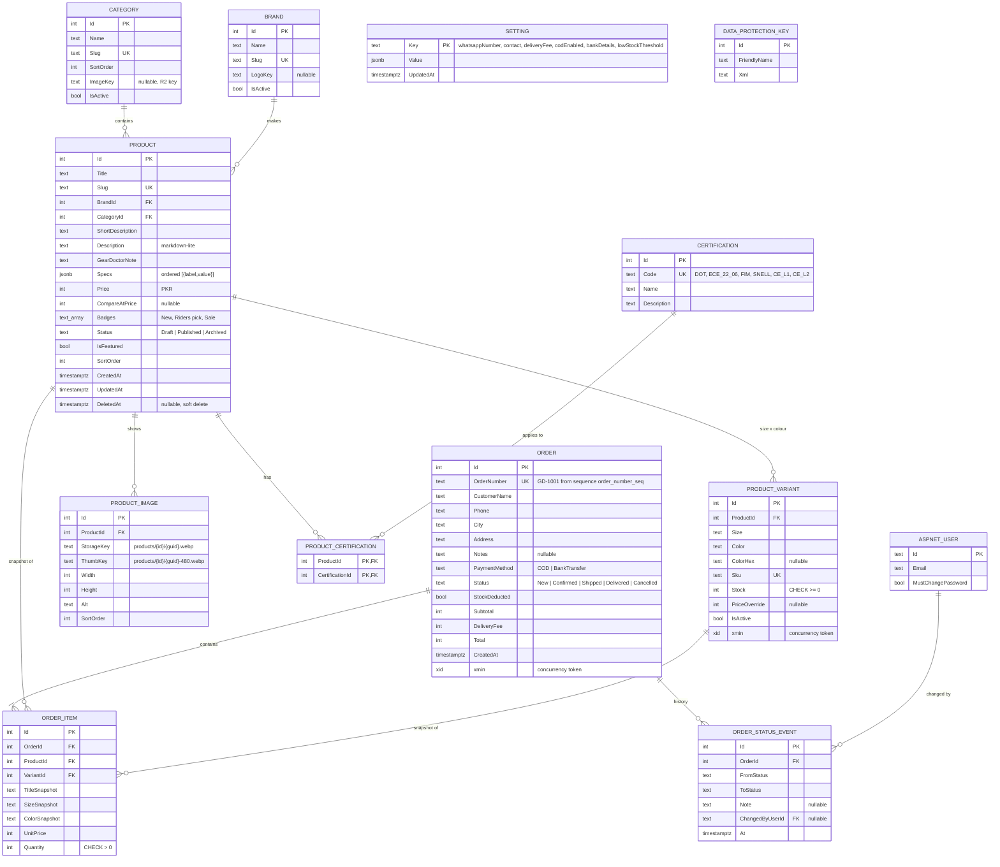

# Backend + Admin: Phase 1 plan (checkpoint ⏸)

Status: **proposal for review**. Nothing below is built yet. Approve it (or change it) before Phase 1 starts.

## 0. What the research changed

Read on 2026-11-24 from Vercel's own pages (sources in §8):

| Finding | Impact on the brief |
|---|---|
| The Container runtime and multi-service projects (`"services"` + `"rewrites"` in `vercel.json`) exist and are documented, but both are **Beta on all plans**. | We're building production on a beta. The fallback (§4.3) has to stay ready. |
| Documented examples are *framework + framework* and *container + container (nginx frontend)*. **Nothing shows a static site service next to a container API.** | The one-project/one-domain setup is **unverified**. Phase 1 starts with a 30-minute throwaway spike deploy to prove it (§4.2). If it fails, it's your ⏸ fallback call. |
| `/api/users` reaches the backend **with the `/api` prefix kept**. | The API maps routes under `/api`. Good, no path stripping needed. |
| **Request/response body limit is 4.5 MB.** | Presigned direct-to-R2 uploads are required, not optional (already planned). |
| **Hobby: functions run in one region (`iad1`, US-East)**, 2 GB / 1 vCPU, 300 s max. Pro allows other regions. | From Pakistan every API call does a ~250 ms round trip to Virginia. On Hobby, Neon must also be in `aws-us-east-1` (same region as the function, or every DB query pays that again). On Pro, move both to Singapore/Mumbai. |
| **Hobby is "non-commercial, personal use only."** Commercial use needs **Pro (~$20/month)**. | ⚠ The "$0" criterion only holds during development. A live store taking orders must be on Pro. Flagged, see §6. |
| Function instances scale in after 5 min idle (prod); SIGTERM + 30 s. Local files aren't durable. | Matches the brief's serverless rules (no startup migrations, Data Protection keys in Postgres, no in-memory state). |

## 1. Repo structure (decision: move the storefront to `/web`)

```
/web/                      storefront (moved from repo root: index.html, css/, js/, assets/, tools/head.mjs …)
/admin/                    Angular workspace → builds to admin/dist/admin/browser, base href /admin/
/api/
  GearDoctor.sln
  Directory.Build.props    net10.0, nullable, warnings-as-errors, central package versions
  src/GearDoctor.Api/              Program.cs, endpoint groups, auth, OpenAPI, Dockerfile.vercel
  src/GearDoctor.Application/      services, DTOs, FluentValidation validators, Result<T>, interfaces
  src/GearDoctor.Domain/           entities, enums, domain rules (no EF/ASP.NET references)
  src/GearDoctor.Infrastructure/   AppDbContext, migrations, Identity, R2 storage, Turnstile, seed
  tests/GearDoctor.Tests/          xUnit + Testcontainers Postgres (CI) / Neon test branch (local)
/docs/  CONTRACTS.md  API.md  DEPLOY.md  BUILD_LOG.md  ADMIN_GUIDE.md  backend/PLAN.md  backend/openapi.draft.yaml
vercel.json
.github/workflows/ci.yml   build+test API, build admin, EF migration bundle → Neon
.env.example
```

**Why move the storefront to `/web`:** Vercel services each need their own `root`. A root-level site would put `api/` and `admin/` source inside the public static output. The cost: GitHub Pages currently serves the repo root, so the Pages preview is retired when we switch to Vercel. Paths inside the site are already relative, so the move is mechanical.

## 2. Database schema (EF Core, Npgsql, Neon)

Money = `integer` PKR everywhere. Soft delete on Product (`DeletedAt`, global query filter). `xmin` concurrency token on ProductVariant and Order.



Decisions:
- **Status history is a child table** (`ORDER_STATUS_EVENT`) rather than jsonb. It's queryable, it records who changed what, and it doubles as the start of the Phase 4 audit log.
- **`StockDeducted` flag on Order** makes deduct/restore idempotent: Confirmed deducts only if false, and Cancelled restores only if true.
- **Stock deduction** runs in a transaction. Each variant does `UPDATE … SET stock = stock - @q WHERE id = @id AND stock >= @q`, and the order fails if any row count is 0. That's atomic in Postgres and race-proof without relying on retries. The `xmin` token still guards admin edits to the same variant.
- **Order placement doesn't deduct stock.** It validates availability and prices, and stock is deducted at **Confirmed**, as the brief specifies. Two customers can both *place* an order for the last item, but only one can be *confirmed*: the second confirm fails with a clear "out of stock" error in admin. Say if you'd rather hold stock at placement.
- Indexes: `Product(Slug)` unique (filtered `DeletedAt IS NULL`), `Product(Status, CategoryId, BrandId, SortOrder)`, `ProductVariant(Sku)` unique, `Order(OrderNumber)` unique, `Order(CreatedAt DESC)`, `Order(Status)`. Optional Phase 2: a GIN trigram index on `Product.Title` for search.
- `OrderNumber`: `'GD-' || nextval('order_number_seq')`, starting at 1001.
- Specs is stored as an **ordered array** `[{label, value}]`, not an object, so the admin can reorder rows.

## 3. API contract

Full draft: [`openapi.draft.yaml`](openapi.draft.yaml) (OpenAPI 3.1). Summary:

| Area | Endpoints |
|---|---|
| Public (cached `public, s-maxage=60, stale-while-revalidate=600`) | `GET /api/products`, `GET /api/products/{slug}`, `GET /api/products/featured`, `GET /api/categories`, `GET /api/brands`, `GET /api/certifications`, `GET /api/settings/public`, `GET /api/health` |
| Public (no cache) | `POST /api/orders` (Turnstile; server pricing), `POST /api/cart/validate` (re-check prices/stock for the cart) |
| Auth | `POST /api/auth/login`, `POST /api/auth/logout`, `GET /api/auth/me`, `POST /api/auth/change-password`, `GET /api/auth/csrf` |
| Admin products | list/get/create/update/duplicate/publish/unpublish/delete/reorder, `PUT …/variants` (bulk grid), `POST /api/admin/variants/{id}/stock` |
| Admin images | `POST /api/admin/uploads/presign`, `POST /api/admin/products/{id}/images`, reorder, delete |
| Admin catalog | categories + brands CRUD + reorder |
| Admin orders | list (status/date/search), get, `POST …/status`, `POST …/notes` |
| Admin settings / dashboard | `GET/PUT /api/admin/settings`, `GET /api/admin/dashboard` |

Conventions: JSON camelCase; errors are RFC 9457 **ProblemDetails** (validation errors carry `errors{field:[msg]}`); list endpoints return `{ items, page, pageSize, total }`; money is integer PKR; images are returned as full URLs (`R2_PUBLIC_BASE_URL + key`); timestamps are ISO-8601 UTC.

Added to the brief (flag if you disagree): `POST /api/cart/validate` (the cart re-validation needs it), `GET /api/auth/csrf` (issues the antiforgery token for the admin SPA), and `ThumbKey` on images (grids load a 480 px thumbnail).

### Auth design
- Login checks Identity (lockout after 5 failures, 15 min), then issues a **JWT (HS256, 8 h) in the `gd_auth` cookie**: `HttpOnly; Secure; SameSite=Strict; Path=/api`.
- **CSRF:** double-submit. `GET /api/auth/csrf` sets a readable `gd_csrf` cookie, and the admin sends it back in the `X-CSRF-Token` header on every mutating request. ASP.NET antiforgery validates it, with keys from Data Protection persisted to Postgres so validation works across instances. Same origin plus SameSite=Strict already blocks most CSRF; this is defence in depth.
- Admin seeded on the first run of the migration job (not app startup) from `ADMIN_EMAIL` / `ADMIN_INITIAL_PASSWORD`, with `MustChangePassword = true`. There's no registration endpoint.
- Rate limiting: ASP.NET fixed-window per IP on login (5/min) and orders (10/min). It's per-instance only, so **Turnstile is the real gate** on orders and contact, and lockout is the real gate on login.

## 4. Deployment / `vercel.json` plan

### 4.1 Target: one project, one domain

```jsonc
{
  "$schema": "https://openapi.vercel.sh/vercel.json",
  "services": {
    "api":   { "root": "api/",   "runtime": "container", "entrypoint": "src/GearDoctor.Api/Dockerfile.vercel" },
    "web":   { "root": "web/",   "framework": null, "outputDirectory": "." },
    "admin": { "root": "admin/", "framework": "angular", "outputDirectory": "dist/admin/browser" }
  },
  "rewrites": [
    { "source": "/api/(.*)",   "destination": { "service": "api" } },
    { "source": "/admin",      "destination": { "service": "admin" } },
    { "source": "/admin/(.*)", "destination": { "service": "admin" } },
    { "source": "/(.*)",       "destination": { "service": "web" } }
  ]
}
```
The Angular SPA fallback (`/admin/orders/42` → `index.html`) is handled inside the admin service with its own rewrite. The exact keys for static services (`framework: null`, `outputDirectory`) are **not documented** on the pages I could read, so the spike settles them.

### 4.2 Spike (first task of Phase 1, ~30 min, throwaway branch + preview deploy)
1. A hello-world .NET 10 minimal API in a container (`/api/health`).
2. One static HTML page at `/`, and a static page at `/admin/` with a deep link `/admin/x`.
3. Measure cold and warm latency of `/api/health` from here, and check the `/api` prefix arrives intact.

**Pass** = all three are served from one preview URL. **Fail** = ⏸ I come back to you with the fallback.

### 4.3 Fallback (needs your OK if the spike fails)
Two Vercel projects: `web` (storefront + admin, static, at `<domain>`) and `api` (container, at `api.<domain>`). CORS would be locked to `https://<domain>`, with the cookie `Domain=.<domain>; SameSite=Lax` (Strict breaks cross-subdomain fetch). CSRF stays double-submit.

### 4.4 Regions
On **Hobby**, functions run in `iad1` (US-East), so create Neon in **AWS us-east-1** to keep DB round trips under 5 ms. On **Pro**, use function region `bom1` (Mumbai) and Neon `aws-ap-southeast-1` (Singapore) or the nearest, for roughly 4× faster API responses from Pakistan.

## 5. Phase 1 work breakdown (after approval)

| # | Tier | Task | Owns |
|---|---|---|---|
| 1 | HIGH (me) | Spike deploy (§4.2) | spike branch |
| 2 | HIGH (me) | Solution + Domain + AppDbContext + initial migration + Identity + Data Protection + health + Dockerfile.vercel + vercel.json + `/web` move | api/**, vercel.json, web/ move |
| 3 | MID | Public endpoints (products filters/paging/sort/search, featured, categories, brands, certs, settings/public) + caching headers | api/src/GearDoctor.Api/Endpoints/Public*, Application/Catalog/** |
| 4 | LOW | Seed: import the 28 products, 7 categories, 9 brands and certifications from `site.config.js` (Node exporter → JSON → C# seeder in the migration job) | tools/export-seed.mjs, Infrastructure/Seed/** |
| 5 | LOW | `.env.example`, DEPLOY.md draft, `.github/workflows/ci.yml` | those files |
| 6 | MID | Storefront → API: `js/data/products.js`, shop filters → query params, product page `?slug=` (+ `?id=` redirect), loading skeletons, error/retry state | web/js/data/**, web/js/pages/shop.js, product.js |
| 7 | LOW→fresh | Phase 1 review by a fresh agent against "Done when" | report only |

## 6. Things I need from you

1. **Accounts:** Vercel, Neon and Cloudflare (R2 + Turnstile). I can't create accounts for you. **Cloudflare asks for a payment card to enable R2, even on the free tier.**
2. **A domain:** needed for `images.<domain>` (R2 custom domain) and the one-domain setup. Without one we use the `*.vercel.app` URL plus `pub-….r2.dev` for images, which is dev-only and rate-limited by Cloudflare.
3. **Repo visibility:** the brief says private, but it's **public** right now because of GitHub Pages. Going private turns off the Pages preview, which is fine once Vercel previews exist. OK to switch it to private at the start of Phase 1?
4. **Plan cost:** Hobby is fine for building, but **launch needs Vercel Pro (~$20/month)** under Vercel's terms. Neon Free and R2's free tier stay $0 at this scale.
5. **Local tools:** this machine has **.NET 8 only, no .NET 10 SDK, no Docker, no Angular CLI**. OK to install the **.NET 10 SDK** and the **Angular CLI** (both via winget/npm)? **Docker Desktop** is optional: without it, integration tests run against a throwaway Neon branch locally and in Docker on GitHub Actions.
6. **Stock timing:** deduct at Confirmed (brief, default) or reserve at order placement? See §2.

## 7. Suggestion, not in the brief: move the background frames to R2

The scroll-animation frames are ~14 MB per desktop visit and ~22 MB per phone visit. Served from Vercel they count against the bandwidth allowance (Hobby 100 GB, Pro 1 TB). **R2 has no egress fees**, so serving `frames/` from `images.<domain>` makes that traffic free at any scale. It's a config change (`backdrop.sequences.*.path`) plus a one-time upload. I'd do it in Phase 1 alongside the image pipeline.

## 8. Sources
- [Deploy ASP.NET Core on Vercel with Docker](https://vercel.com/kb/guide/dot-net-asp-net-on-vercel-with-docker)
- [Run any Dockerfile on Vercel](https://vercel.com/blog/dockerfile-on-vercel)
- [Does Vercel support Docker deployments?](https://vercel.com/kb/guide/does-vercel-support-docker-deployments)
- [Vercel Services](https://vercel.com/docs/services)
- [Container runtime](https://vercel.com/docs/functions/runtimes/container)
- [Functions limitations](https://vercel.com/docs/functions/limitations)
- [Vercel fair use guidelines](https://vercel.com/docs/limits/fair-use-guidelines), [Hobby plan](https://vercel.com/docs/plans/hobby)
